# 시로 개발 요구사항 정리

## 1. 서비스 개요

시로는 여러 사람이 함께 식사할 때 음식과 식당을 결정하는 과정을 돕고, 결정된 식당에서 모바일로 주문하는 과정까지 연결하는 서비스다.

사용자는 주변에서 먹을 수 있는 음식 카테고리를 공동으로 소거하고, 남은 카테고리를 판매하는 식당을 다시 소거한다. 최종 식당은 방장이 선택한다. 매장에 도착하면 각 참가자가 자신의 휴대전화로 메뉴를 고르고, 식당이 주문을 확인하면 주문 완료로 처리한다.

앱 안에서 결제는 진행하지 않는다.

## 2. 서비스 참여자

| 역할 | 주요 기능 |
|---|---|
| 방장 | 파티 생성, 장소·검색 범위 설정, 초대, 최종 식당 선택, 매장 QR 연결 |
| 참가자 | 개인 식사 제한 설정, 음식 카테고리 및 식당 검토·소거, 매장 메뉴 선택 |
| 식당 사업자 | 매장·메뉴·재료 정보 등록, 들어온 주문 확인, 주문 완료 처리, 데이터 확인 |
| 비회원·앱 미설치 사용자 | 초대 링크와 웹을 통해 파티 참여, 일반 카메라로 QR을 찍어 웹 주문 화면 이용 |

## 3. 전체 사용자 흐름

```mermaid
flowchart LR
    A[파티 생성] --> B[참가자 초대]
    B --> C[개인 식사 제한 확인]
    C --> D[GPS와 범위 설정]
    D --> E[AI가 음식 카테고리 후보 구성]
    E --> F[음식 카테고리 공동 소거]
    F --> G[전원 검토 완료]
    G --> H[식당 공동 소거]
    H --> I[전원 검토 완료]
    I --> J[방장이 최종 식당 선택]
    J --> K[매장 방문 및 QR 연결]
    K --> L[각자 메뉴 선택]
    L --> M[모임 주문 제출]
    M --> N[식당 확인 대기]
    N --> O[식당이 주문 확인]
    O --> P[주문 완료 및 수수료 기록]
```



## 4. 단계별 요구사항

### 4.1 파티 생성과 참여

방장은 파티를 만들면서 다음 정보를 설정한다.

- 모임 날짜와 시간
- 기준 위치 또는 약속 장소
- 식당 검색 반경
- 예산
- 식사 방식 등 모임 조건

파티가 생성되면 초대 링크를 공유한다. 앱 사용자는 앱에서 참여하고, 앱이 없는 사람은 모바일 웹으로 참여한다.

### 4.2 개인 식사 제한 설정

사용자는 평소에 먹을 수 없는 음식이나 재료를 미리 설정한다.

예시는 다음과 같다.

- 알레르기
- 종교적 제한
- 채식 유형
- 반드시 피해야 하는 재료나 음식 유형

파티 참가자 중 한 명이라도 먹을 수 없는 조건에 해당하면 해당 음식은 공동 후보에서 사전에 제외한다.

AI는 참가자들의 조건과 식당 사업자가 등록한 메뉴·재료 정보를 바탕으로 필터링한다. 정보가 부족하거나 판단이 불확실한 경우의 처리는 아직 정하지 않았다.

### 4.3 음식 카테고리 후보 생성

GPS 또는 방장이 지정한 위치와 검색 범위를 기준으로 주변 등록 식당을 조회한다.

AI는 주변 식당에서 실제로 판매되는 메뉴를 분석해 소거 화면에 표시할 음식 카테고리를 구성한다. 따라서 고정된 전체 카테고리 목록을 보여주는 방식이 아니라, 현재 위치 주변에서 선택할 수 있는 음식에 맞춰 후보가 달라진다.

음식 후보는 특정 식당의 개별 메뉴가 아니라 여러 식당에 걸쳐 적용할 수 있는 음식 단위다. 카테고리의 정확한 세분화 수준은 추후 정의가 필요하다.

### 4.4 음식 카테고리 공동 소거

모든 참가자는 같은 음식 후보군을 검토한다.

- 사용자가 음식을 소거하면 다른 참가자의 화면에도 실시간으로 반영된다.
- 소거한 사용자의 신원은 다른 참가자에게 공개하지 않는다.
- 자신이 소거한 항목은 본인만 취소할 수 있다.
- 여러 사람이 같은 항목을 소거한 경우에는 모든 소거가 취소되어야 다시 후보로 복구하는 규칙이 필요하다.
- 후보가 사용자 화면에 노출되면 해당 사용자의 검토 진행도가 올라간다.
- 모든 참가자가 전체 후보를 확인하고 `검토 완료`를 눌러야 다음 단계로 넘어간다.
- 아무 반응이 없는 사용자를 동의 또는 검토 완료로 간주하지 않는다.

음식 소거 단계가 끝나면 남아 있는 음식 카테고리를 판매하는 식당들이 다음 단계의 후보가 된다.

### 4.5 식당 공동 소거

참가자는 음식 단계에서 남은 카테고리를 판매하는 주변 식당을 검토한다.

식당 카드에는 최소한 다음 정보가 필요하다.

- 식당명
- 위치와 거리
- 대표 메뉴
- 가격
- 남아 있는 음식 카테고리 또는 메뉴
- 식사 제한과 관련된 정보

식당 카드의 확대·축소 또는 펼치기 기능을 통해 대표 메뉴 외의 다른 메뉴도 확인할 수 있어야 한다.

음식 단계와 마찬가지로 다음 규칙을 적용한다.

- 식당 소거 결과는 참가자들에게 실시간으로 반영한다.
- 소거한 사람은 익명으로 표시한다.
- 본인이 소거한 식당만 본인이 복구할 수 있다.
- 모든 참가자가 식당 후보를 확인하고 `검토 완료`를 눌러야 한다.

후보 수가 특정 개수로 줄어들었다고 자동 종료하지 않는다. 전원의 검토 완료 여부가 종료 조건이다.

### 4.6 최종 식당 선택

식당 검토가 끝나면 방장이 남은 후보 중 최종 식당을 선택한다.

현재 구상에서는 방장에게 최종 결정권을 준다. 식당의 자동 순위 산정 방식과 추천 기준은 아직 확정되지 않았다.

### 4.7 매장 방문과 QR 연결

최종 식당에 도착한 후 방장이 매장의 QR을 스캔한다.

QR 연결이 완료되면 파티 참가자들의 휴대전화에 해당 매장의 모바일 주문 화면이 열린다. 기존 키오스크 기기와 직접 연동하는 기능은 개발 범위에서 제외한다.

앱이 없는 일반 방문객이 휴대전화 기본 카메라로 QR을 스캔한 경우에는 해당 식당의 일반 웹 주문 화면으로 이동한다.

구현 시 다음 두 주문 유형을 구분해야 한다.

- 시로 파티에 연결된 공동 주문
- 파티 없이 QR로 접속한 일반 주문

### 4.8 메뉴 선택과 주문 제출

파티 참가자는 각자의 휴대전화에서 자신이 먹고 싶은 실제 메뉴를 선택한다.

각 참가자의 선택은 하나의 파티 주문으로 취합한다. 주문을 제출할 수 있는 사람과 제출 전 수정 권한은 아직 구체화가 필요하다.

앱에서는 결제 기능을 제공하지 않는다. 주문 제출 이후의 상태는 다음과 같다.

```text
메뉴 선택 중
→ 주문 제출
→ 식당 확인 대기
→ 식당 확인
→ 주문 완료
```

### 4.9 식당의 주문 확인

사장님 웹에 새로운 주문이 표시된다. 식당 측에서 주문 내용을 확인하고 `확인` 버튼을 누르면 주문이 완료된 것으로 처리한다.

식당의 확인 기록은 다음 목적으로 사용한다.

- 사용자에게 주문 확정 상태 표시
- 실제 주문 발생 기록
- 식당에 청구할 서비스 수수료 산정

현재 수수료는 앱 결제 금액에서 자동 공제하는 구조가 아니다. 식당이 확인한 주문 기록을 기준으로 별도 청구한다.

수수료 계산 기준이 주문 건수인지 주문 금액의 일정 비율인지는 추가 결정이 필요하다.

## 5. 사장님 웹

사장님 웹의 주요 기능은 다음과 같다.

### 매장 관리

- 매장 기본 정보 등록 및 수정
- 위치와 영업 정보 관리
- QR 생성 또는 매장 QR 연결

### 메뉴 관리

- 메뉴명
- 메뉴 사진
- 가격
- 음식 카테고리
- 주요 재료
- 알레르기 및 식사 제한 관련 정보
- 대표 메뉴 여부
- 판매 가능 여부

사업자가 직접 등록한 정보가 AI 필터링과 사용자 후보 생성의 기반이 된다.

### 주문 관리

- 신규 주문 확인
- 참가자별 선택 또는 취합된 전체 주문 확인
- 주문 확인 처리
- 주문 상태 조회
- 수수료 청구 대상 기록 조회

### 데이터 확인

초기 데이터 화면에서는 다음 이벤트를 구분해서 다루는 것이 적절하다.

| 이벤트 | 의미 |
|---|---|
| 노출 | 사용자의 화면에 음식 또는 식당이 표시됨 |
| 소거 | 사용자가 직접 후보를 제외함 |
| 소거 취소 | 사용자가 본인의 제외 결정을 취소함 |
| 생존 | 검토 종료 시 후보로 남아 있음 |
| 식당 확정 | 방장이 최종 식당으로 선택함 |
| 메뉴 선택 | 매장에서 사용자가 실제 메뉴를 선택함 |
| 주문 제출 | 파티 주문이 식당에 전달됨 |
| 주문 확인 | 식당이 주문을 확인해 완료 처리함 |

단순히 소거되지 않았다는 이유만으로 선호한 것으로 판단하면 안 된다. 노출, 직접 소거, 최종 선택, 실제 주문을 각각 별도의 행동으로 기록해야 한다.

## 6. 실시간 동기화 규칙

다음 정보는 파티 참가자 사이에서 실시간으로 동기화되어야 한다.

- 참가자 입장과 준비 상태
- 음식 카테고리 소거 및 복구
- 식당 소거 및 복구
- 참가자별 검토 진행도
- 검토 완료 상태
- 방장이 선택한 최종 식당
- 매장 QR 연결 상태
- 참가자별 메뉴 선택 상태
- 주문 제출과 식당 확인 상태

다른 참가자에게 소거자의 신원을 공개하지 않더라도, 시스템 내부에는 소거한 사용자 ID를 저장해야 한다. 그래야 본인만 자신의 소거를 취소할 수 있다.

## 7. 핵심 데이터 구조

개발 시 최소한 다음 데이터가 필요하다.

| 데이터 | 주요 내용 |
|---|---|
| 사용자 | 계정, 식사 제한, 알레르기, 웹 임시 사용자 여부 |
| 파티 | 방장, 위치, 반경, 시간, 예산, 현재 단계, 상태 |
| 파티 참가자 | 사용자, 참여 상태, 검토 진행도, 검토 완료 여부 |
| 식당 | 사업자, 위치, 영업 정보, 등록 상태 |
| 음식 카테고리 | 이름, 상위·하위 분류, AI 분류 정보 |
| 메뉴 | 식당, 카테고리, 가격, 재료, 알레르기 정보, 판매 상태 |
| 소거 기록 | 파티, 단계, 대상, 사용자, 소거·복구 시각 |
| 노출 기록 | 파티, 사용자, 대상, 최초 노출 시각 |
| 식당 선택 | 파티, 최종 식당, 선택한 방장, 선택 시각 |
| 파티 주문 | 파티, 식당, 주문 상태, 제출·확인 시각 |
| 주문 항목 | 참가자, 메뉴, 수량, 요청 사항 |
| 수수료 기록 | 주문, 과금 기준, 청구 상태 |

## 8. 사용자 화면 범위

MVP에 필요한 사용자 화면은 다음과 같다.

1. 홈 및 진행 중인 파티
2. 파티 생성
3. 초대 링크 참여
4. 개인 식사 제한 설정·확인
5. 파티 대기실
6. 음식 카테고리 소거
7. 식당 소거
8. 식당 후보 및 지도 확인
9. 방장의 최종 식당 선택
10. 확정된 식당 안내
11. 매장 QR 스캔·연결
12. 개인 메뉴 선택
13. 공동 주문 내역 확인
14. 식당 확인 대기
15. 주문 완료

## 9. 사장님 웹 화면 범위

MVP에 필요한 사장님 화면은 다음과 같다.

1. 로그인
2. 매장 정보 관리
3. 음식 카테고리 및 메뉴 등록
4. 재료·알레르기 정보 등록
5. 실시간 주문 목록
6. 주문 상세
7. 주문 확인 처리
8. 확인된 주문과 수수료 대상 내역
9. 기본 데이터 현황

광고 상품 관리와 고급 데이터 분석은 서비스의 사업모델에는 포함되지만, 해커톤 MVP에 포함할지는 아직 확정되지 않았다.

## 10. AI의 역할

현재 정의된 AI 역할은 다음과 같다.

- GPS 및 검색 범위 안의 등록 식당과 메뉴 분석
- 메뉴를 음식 카테고리로 분류
- 참가자들의 식사 제한과 메뉴 재료 정보를 비교
- 먹을 수 없는 음식 카테고리를 공동 후보에서 사전 제거
- 소거 화면에 표시할 지역 기반 음식 후보 생성

AI가 식당의 순위를 직접 결정하는지, 추천 이유를 생성하는지, 정보가 부족한 메뉴를 어떻게 처리하는지는 추가 정의가 필요하다.

## 11. 사업모델

시로의 사업모델은 다음 세 가지다.

- 식당이 확인한 주문을 기준으로 부과하는 주문 수수료
- 사용자 화면에서 식당을 상단에 노출하는 광고 상품
- 노출·소거·식당 선택·메뉴 선택·주문 과정에서 축적된 데이터를 활용한 분석 상품

데이터 상품은 특정 개인을 식별하는 형태가 아니라 집계된 형태를 전제로 한다.

## 12. 개발 형태

- 개발 인원: 3명
- 사용자 서비스: 모바일 앱과 모바일 웹
- 사업자 서비스: 웹
- 앱 설치 사용자: 앱에서 이용
- 앱 미설치 사용자: 초대 링크 또는 QR을 통해 웹에서 이용
- 매장 주문: 기존 키오스크 연동 없이 휴대전화 주문 화면으로 구현
- 결제: 서비스 범위에서 제외
- 주문 성립 기준: 식당 사업자의 주문 확인

사용자 앱과 웹이 같은 파티에 참여하고 실시간 상태를 공유해야 하므로, 기능과 데이터 구조를 공통으로 설계해야 한다.

## 13. MVP 핵심 성공 흐름

해커톤 시연에서 가장 중요한 흐름은 다음과 같다.

> 방장이 파티를 만들고 참가자를 초대한다. AI가 위치와 식사 제한을 반영해 음식 후보를 만든다. 참가자들이 음식과 식당을 공동으로 소거하고 방장이 식당을 확정한다. 매장에서 QR을 연결한 뒤 각자 메뉴를 선택한다. 주문을 제출하면 사장님 웹에 표시되고, 사장님이 확인하면 모든 참가자에게 주문 완료가 표시된다.

## 14. 개발 전에 추가로 확정할 항목

아래 항목은 현재 방향을 바꾸지는 않지만, 구현 전에 팀 내부에서 규칙을 정해야 한다.

- 음식 카테고리의 세분화 기준
- AI 판단이 불확실하거나 재료 정보가 없는 음식의 처리
- 후보가 모두 소거되었을 때의 복구 방식
- 여러 사용자가 같은 후보를 소거했을 때의 복구 조건
- 검토 중 새로운 참가자가 들어왔을 때의 처리
- 검토 완료 후 소거를 다시 수정할 수 있는지
- 방장이 최종 식당을 고른 뒤 되돌릴 수 있는지
- QR 연결 결과를 모든 참가자에게 전달하는 방식
- 개인 메뉴 선택을 누가 최종 제출하는지
- 식당이 주문을 거절하거나 수정 요청할 때의 상태
- 주문 금액을 서비스에 입력할지 여부
- 수수료의 계산 기준과 청구 주기
- 광고 식당을 후보에 노출하는 규칙
- 식사 제한 및 행동 데이터의 보관 기간